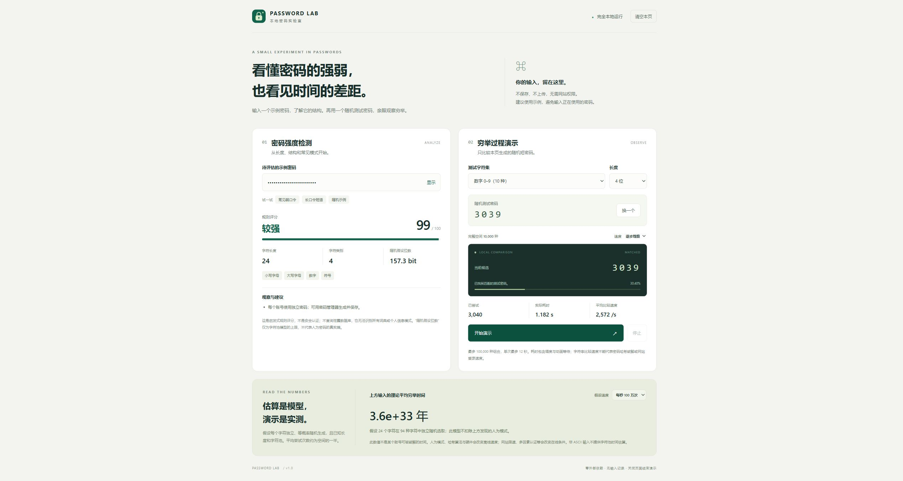

# Password Lab · 本地密码实验室

一个无需安装依赖的 Microsoft Edge Manifest V3 扩展。提供中文密码强度评估、理论时间估算，以及**只针对本页生成的随机短测试密码**的穷举演示。

[下载可安装 ZIP](downloads/password-lab-edge-1.0.0.zip?raw=true) · [测试记录](TESTING.md)



## 安装到 Edge

1. 如果拿到 ZIP，先解压。源码用户直接使用 `extension/` 文件夹。
2. 在 Edge 地址栏打开 `edge://extensions`，开启“开发人员模式”。
3. 选择“加载解压缩的扩展”，选中**包含 `manifest.json` 的文件夹**。
4. 点击扩展图标，再点击“打开实验室”。

无需打包成 CRX，无需 Microsoft Edge Add-ons 商店账号。GitHub 托管源码与安装 ZIP 不等于上架扩展商店。

安装流程参考 [Microsoft Edge 本地加载扩展文档](https://learn.microsoft.com/en-us/microsoft-edge/extensions/getting-started/extension-sideloading)。

## 使用

- **强度检测**：输入示例密码，或点击弱口令、长口令短语、随机示例。观察长度、字符类别、常见口令变体、连续字符和重复模式。默认隐藏输入，最长 128 个 UTF-16 代码单元。
- **穷举演示**：选择内置字符集和 2–5 位长度。目标由 `crypto.getRandomValues` 在本地生成，不接受网站地址、账户、外部目标或待破解哈希。演示将固定长度空间按顺序逐个比较。
- **实测数据**：显示最新候选、已尝试次数、空间覆盖率、实际耗时、平均比较速度。点击“停止”立即终止 Worker。再次开始从头遍历同一个测试密码；“换一个”重新生成。
- **边界**：完整空间最多 100,000 种组合，运行最多 12 秒；不支持的组合会提示减小范围。快速模式有较少动画等待，逐步模式方便观察。
- **清空**：顶部“清空本页”终止演示并清空密码、测试目标和显示结果。关闭或离开页面会终止计算。

## 如何理解结果

**规则评分是教学用启发式评分，不是经过验证的专业密码估计器，也不是安全认证。** 有限的内置常见口令表无法覆盖所有词典词、姓名、拼音、个人信息或组合模式。不查询泄露数据库，不保证高分密码安全。

对于可打印 ASCII 输入，字符池按已出现类别估计：小写字母 26、大写字母 26、数字 10、符号 32、空格 1。显示的随机假设位数为 `L × log2(R)`，它是**每位独立等概率随机生成**条件下的模型值，不是人为密码的真实熵。非 ASCII 输入仍可规则评估，但不显示字符池时间估计。

检测到常见口令、连续字符、重复或年份等可预测模式时，界面会显示“存在可预测模式”，不展示可能高估安全性的随机模型耗时。未检测到模式也不意味着输入一定随机。

若已知长度与字符池，完整空间为 `N = R^L`。固定顺序下随机目标的平均尝试次数为 `(N + 1) / 2`；假设每秒比较 `v` 次，平均时间为 `(N + 1) / (2v)`。三档速度仅是模型参数，不代表任何网站、哈希算法或硬件的性能。

演示做的是**内存中的明文字符串比较**；计时包含 Worker 调度与动画等待，搜索在目标出现时结束，因此覆盖率可能小于 100%。界面估算与演示实测不能当作真实登录破解耗时。在线限速、多因素认证，以及离线哈希算法与硬件都会改变条件。

## 隐私与结构

- 没有 `permissions`、`host_permissions` 或网页注入脚本，不读取网页、登录表单、Cookie、历史记录或密码管理器。
- 没有后端、遥测、远程字体、远程脚本或外部运行依赖。
- 不使用 `localStorage`、`sessionStorage`、IndexedDB 或 `chrome.storage`。输入与演示状态只留在页面内存中，关闭后不持久化；不声称能从浏览器进程内存中安全擦除每个副本。
- CSP 的 `connect-src 'none'` 禁止扩展页面和 Worker 发起网络连接。仅使用随扩展打包的模块与样式，参见 [Chrome 扩展 CSP 文档](https://developer.chrome.com/docs/extensions/reference/manifest/content-security-policy)。
- 建议使用示例密码，避免把正在使用的真实密码输入任何不熟悉的工具。

```text
extension/         可直接加载的扩展（无需构建）
  lab.html         实验室界面
  core.js          评分、字符池估算、演示配置与随机生成
  worker.js        有上限的本地逐个比较
  app.js           页面交互与计算生命周期
  popup.*          工具栏入口
  icons/           随包图标
tests/             Node.js 内置测试，无第三方测试依赖
tools/             本地预览与 ZIP 打包
assets/icon.svg    可编辑的图标源文件
```

## 开发与测试

需要 Node.js 20 或更高版本；不需要 `npm install`。

```sh
npm test
npm run preview
npm run package
```

`preview` 只监听 `http://127.0.0.1:4173`，供浏览器界面预览；安装扩展后离线运行无需启动它。`package` 将 `extension/` 文件的内容打包到 `dist/password-lab-edge-1.0.0.zip`，ZIP 根目录包含 `manifest.json`。

测试覆盖规则评分、Unicode、模型公式、候选空间完整性、随机采样边界、Worker 的首尾匹配、配置拒绝、时间上限与终止，以及清单的权限/CSP 限制。

## 源码与安装包

公开源码仓库：[haozhizzz/password-lab-edge](https://github.com/haozhizzz/password-lab-edge)。`downloads/` 提供可直接解压加载的安装 ZIP，源码中的 `extension/` 也可直接加载。

获取源码：

```sh
git clone https://github.com/haozhizzz/password-lab-edge.git
cd password-lab-edge
```

`dist/` 与临时 `artifacts/` 不进入源码提交；`docs/preview.jpg` 是示例界面截图，不含实际账号密码。

## License

[MIT](LICENSE)
